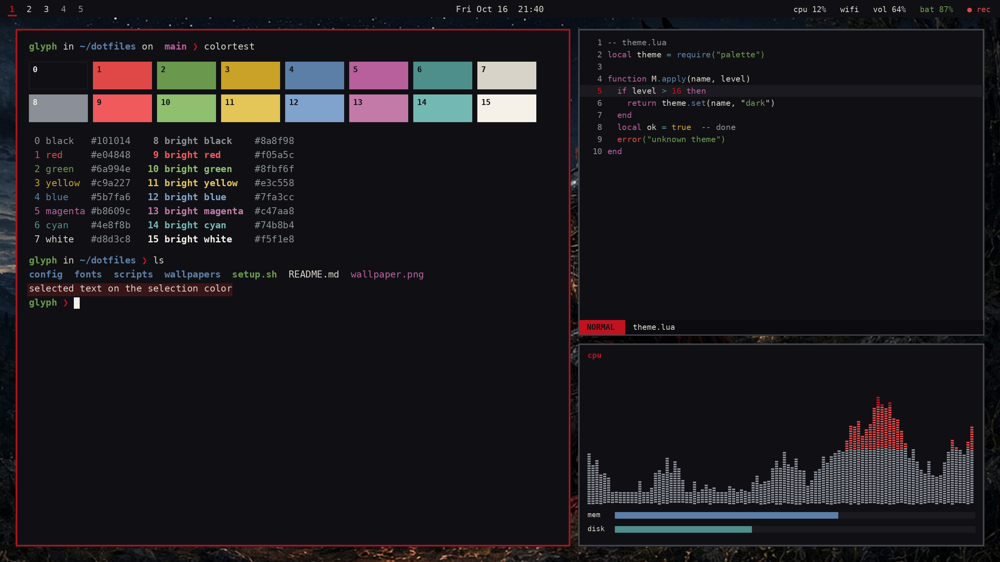
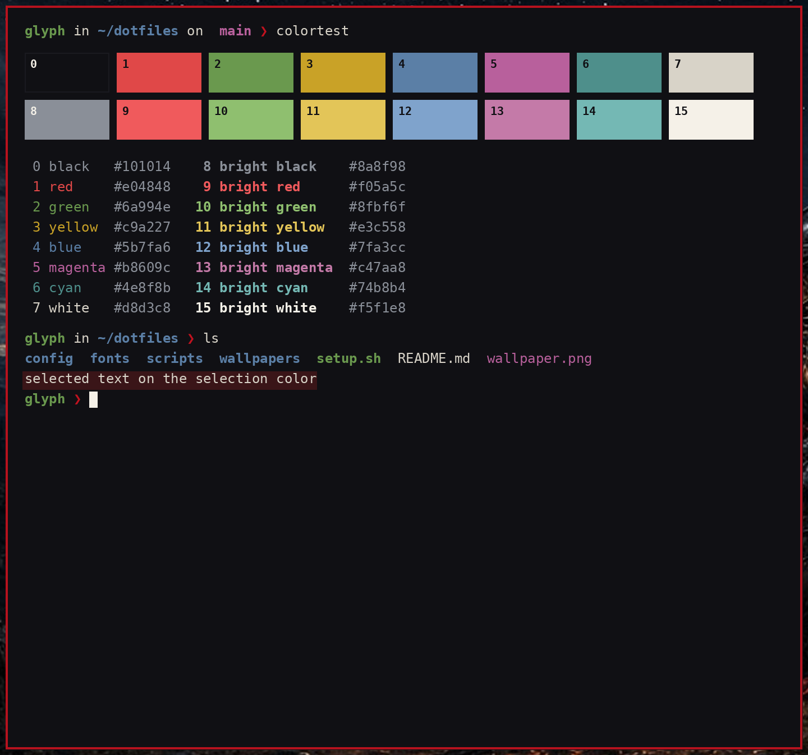
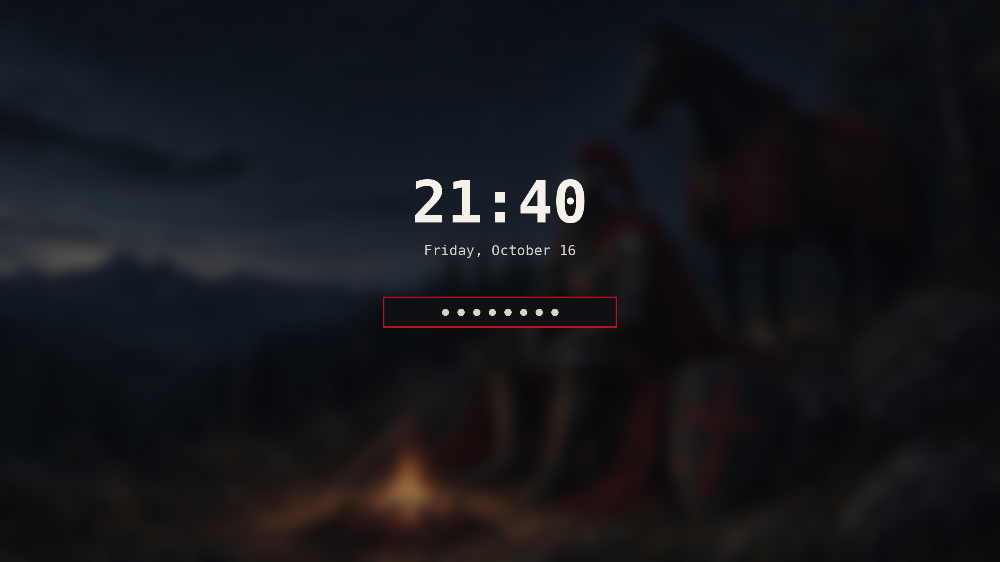

# Blackshield

Black Steel for Omarchy: a near-black steel base with bone-white type and a single blood-crimson edge. Iron, parchment and blood, and no gradients.

**Version:** 0.1.0 · **For:** Omarchy (Hyprland) 4.0+ · **Mode:** dark



## Screenshots

| Terminal + editor | Lock screen |
|---|---|
|  |  |

## What it themes

Omarchy 4 renders every app config from `colors.toml`, so this theme ships a palette rather than
per-app files. Switching to it colours:

- **Hyprland** window borders: solid crimson `#c1121f` on the active window and dim steel `#8f959c` on inactive ones. There is no gradient, by design
- **Omarchy shell**: a hand-tuned `shell.toml` gives a matte near-black bar with a crimson active marker, and crimson-edged menus, launcher, notifications, polkit prompt and image picker. `shell.lock.toml` styles the lock screen the same way
- **Terminals**: Alacritty, Ghostty, Kitty and Foot (all 16 ANSI colours, with reds lifted so they stay readable: `#e04848` and bright `#f05a5c`)
- **Editors**: Neovim (aether), Helix, VS Code/Cursor (generated theme), Obsidian
- **btop**: a hand-tuned `btop.theme` with steel-to-gold-to-crimson CPU and process graphs, a green-to-crimson temperature scale and gold-to-red download graphs
- **Chromium/Brave** toolbar colour, the keyboard backlight (crimson where supported), fcitx5, gum, and the other templated apps
- **GTK icons**: `Yaru-red`, whose red accent matches the crimson
- **Lock screen**: `unlock.png`, a red pixel Omarchy logo
- **Wallpapers**: eight 2560x1440 images in `backgrounds/` that tell a knight's story, in order: `01-camp-vigil` (default), `02-night-ride`, `03-contracts`, `04-battle`, `05-forest-campfire`, then three pixel-art knights: `06-pixel-shield`, `07-pixel-campfire` and `08-pixel-rampart`. Cycle through them with `omarchy-theme-bg-next`

## Ultrawide extras

`extras/ultrawide/` holds four 2560x1080 originals for 21:9 screens: `01-camp.png` (the camp vigil),
`05-campfire-ultrawide.jpg` (the forest campfire), `05-knight.png` (the pixel shield) and `08-knight-night.png`
(the pixel rampart). They ship with every install method but are not in the background rotation. To add them to it:

```bash
mkdir -p ~/.config/omarchy/backgrounds/blackshield
cp ~/.config/omarchy/themes/blackshield/extras/ultrawide/* ~/.config/omarchy/backgrounds/blackshield/
```

## Theme files

| File | Purpose |
|---|---|
| `colors.toml` | The palette. Omarchy renders Hyprland, terminal, shell, editor and app configs from it |
| `btop.theme` | Colour-only btop override (kept by every install method) |
| `shell.toml`, `shell.lock.toml` | Omarchy shell and lock screen overrides (kept by every install method; Omarchy merges `shell.lock.toml` into the `[lock]` section of `shell.toml` when it applies the theme) |
| `icons.theme` | GTK icon theme name (`Yaru-red`) |
| `unlock.png` | Lock screen logo |
| `backgrounds/` | Wallpapers (`01-camp-vigil.png` is the default) |
| `extras/ultrawide/` | Optional 2560x1080 originals, not in the rotation |
| `preview.png` | Theme picker preview |
| `screenshots/` | Images for this README |
| `install.sh`, `uninstall.sh` | Optional installer for the release tarball |

## Palette

| Role | Hex | | Role | Hex |
|---|---|---|---|---|
| background | `#101014` | | foreground | `#d8d3c8` |
| dark_background | `#0c0c10` | | light_foreground | `#e8e4db` |
| darker_background | `#070709` | | bright_foreground / cursor | `#f5f1e8` |
| lighter_background | `#1a1a20` | | dark_foreground | `#8a8f98` |
| selection | `#3a1518` | | muted (comments, bright black) | `#8a8f98` |
| accent (crimson) | `#c1121f` | | orange / brown | `#f05a5c` / `#8f741b` |
| border active | `#c1121f` (solid, ee alpha) | | border inactive | `#8f959c` (66 alpha) |

| ANSI | Normal | Bright |
|---|---|---|
| black | `#101014` (0) | `#8a8f98` (8) |
| red | `#e04848` (1) | `#f05a5c` (9) |
| green | `#6a994e` (2) | `#8fbf6f` (10) |
| yellow | `#c9a227` (3) | `#e3c558` (11) |
| blue | `#5b7fa6` (4) | `#7fa3cc` (12) |
| magenta | `#b8609c` (5) | `#c47aa8` (13) |
| cyan | `#4e8f8b` (6) | `#74b8b4` (14) |
| white | `#d8d3c8` (7) | `#f5f1e8` (15) |

All text colours reach at least 4.5:1 against the background (the lowest is ANSI blue at 4.55:1). Bright black
`#8a8f98` is 5.84:1, so comments stay readable. The crimson accent is 3.05:1 and is meant for borders, the bar
and highlights, not body text. ANSI 0 is the background itself, the Omarchy convention.

## Requirements

- Omarchy 4.0 or newer (Omarchy 4 renders app configs from `colors.toml`)
- `git` (for the git and `omarchy-theme-install` methods)
- Optional: icon theme `Yaru-red` (named in `icons.theme`)
- No root access needed

## Install

Pick one method.

**1. Omarchy's installer (recommended)**

```bash
omarchy-theme-install https://github.com/Blackshield-Company/omarchy-blackshield-theme
```

**2. Git clone into the themes folder**

```bash
git clone https://github.com/Blackshield-Company/omarchy-blackshield-theme ~/.config/omarchy/themes/blackshield
omarchy-theme-set blackshield
```

**3. Release tarball with the bundled installer** (backs up any existing theme of the same name and writes a manifest)

```bash
tar -xzf blackshield-0.1.0.tar.gz
cd blackshield
./install.sh --dry-run   # preview
./install.sh --apply     # install and switch to it
```

Checksum: `sha256sum -c blackshield-0.1.0.tar.gz.sha256`

**4. Copy it by hand** (a plain copy without `.git` counts as your own theme, so Omarchy uses every file)

```bash
cp -r blackshield ~/.config/omarchy/themes/blackshield
omarchy-theme-set blackshield
```

> Themes installed with git (methods 1 and 2) only take colour files: Omarchy ignores `*.lua`, terminal
> configs and `vscode.json` from git repos for safety. This theme puts everything into `colors.toml`, so
> every method gives the same result.

## Uninstall

- Installed with method 1, 2 or 4: switch to another theme, then `omarchy-theme-remove blackshield`
- Installed with method 3: `./uninstall.sh` (switches away if the theme is active, removes only the files it added and restores your backup). Use `./uninstall.sh --dry-run` to preview.

## Changelog

See [CHANGELOG.md](CHANGELOG.md).

## License

MIT © 2026 synthalorian. See [LICENSE](LICENSE).

## Credits

- Design and packaging: synthalorian
- Thanks to the aether.nvim project, whose colorscheme Omarchy uses to theme Neovim
- Wallpapers: original artwork by synthalorian (MIT, same as the theme)
- Built for [Omarchy](https://omarchy.org) by DHH and contributors
